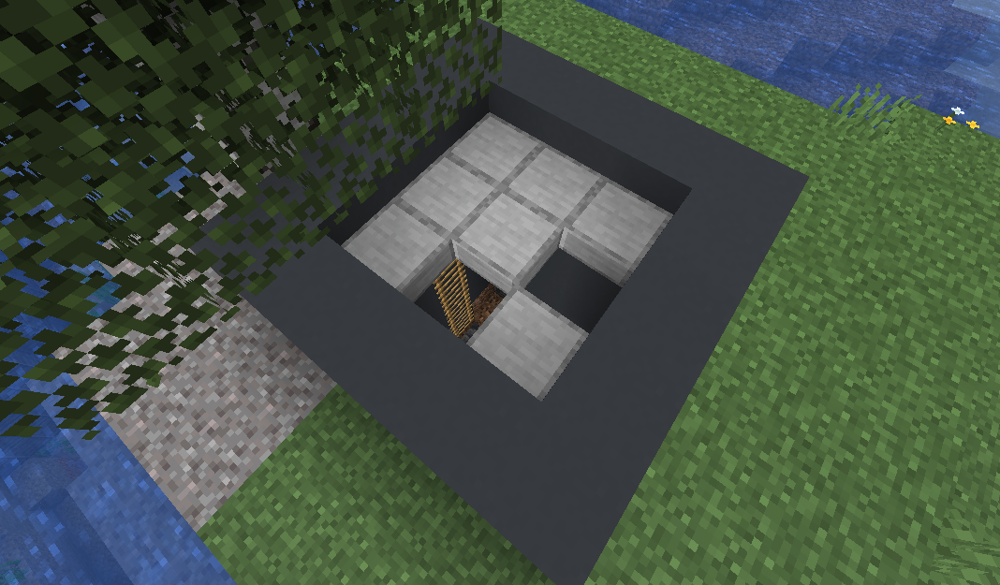
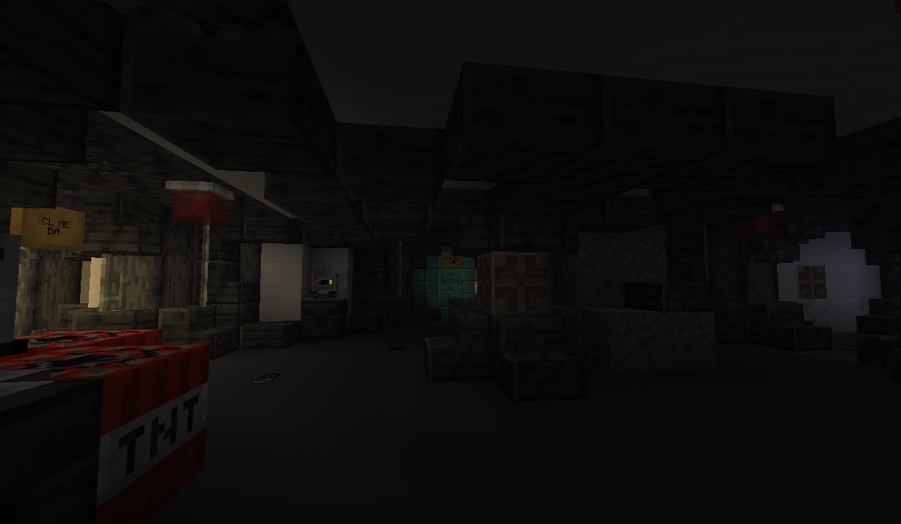

# Abandoned Bunker

Abandoned bunkers are an uncommon structure that generate partially buried.  They may be spotted by a concrete and stone slab entrance hatch that generates above-ground:

Bunkers are the only location where [suspicious thumb drives](suspicious_thumb_drive.md) are found.  All abandoned bunkers generate with exactly one [suspicious thumb drive](suspicious_thumb_drive.md) per structure.

In addition to [suspicious thumb drives](suspicious_thumb_drive.md), bunkers contain several other devices added by Lockdown, including [alarms](alarm_light.md), [drones](drone.md), [turrets](turret.md), and more.  Additionally, [drones](drone.md) and [turrets](turret.md) found inside the bunker will invariably be hostile to any intruding players.

## Generation

Abandoned bunkers are found in the same biomes as [trail ruins](https://minecraft.wiki/w/Trail_Ruins), i.e. jungles, old growth birch forests, old growth pine taigas, old growth spruce taigas, snowy taigas, and taigas.

All abandoned bunkers consist of the following rooms:
* Entrance
* Atrium
* Robotics lab
* Research lab
* Barracks

Several of these rooms have multiple variants:
* Atrium
    * Regular
    * Collapsed
    * Infested
* Research lab
    * Genetics lab
    * Dimensions lab
    * Anomaly lab
* Barracks
    * Barracks (struggle)
    * Barracks (cult)
    * Clone bay (does not generate in versions below 1.21.9)

> **Note**: The clone bay room uses features available in 1.21.9 and above.  As such, this room is excluded from generation in versions below 1.21.9.

## History

| Version | Changes                |
| ------- | ---------------------- |
| R4      | Added abandoned bunker |
