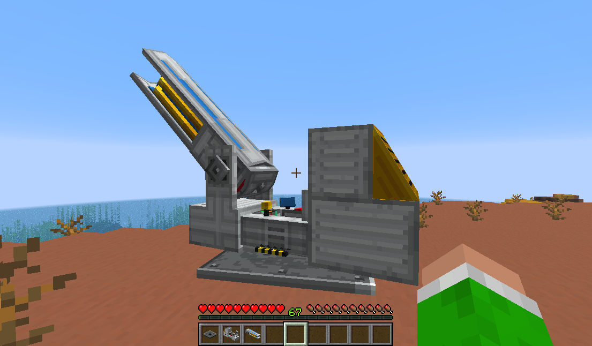
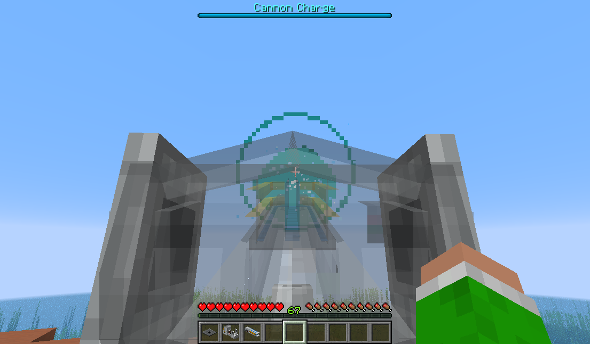
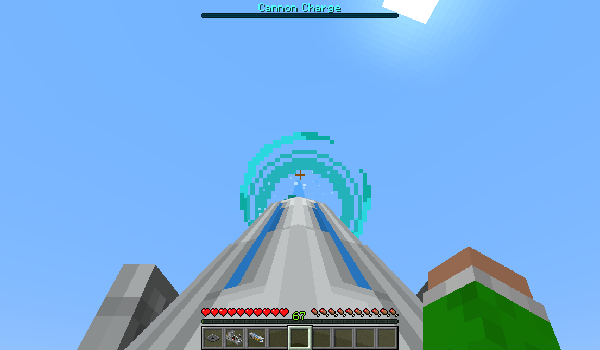
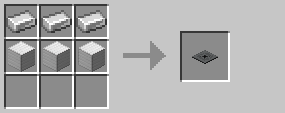
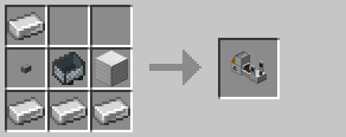
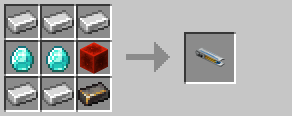

# Air Defense Cannon



The air defense cannon is a stationary, player-controllable vehicle that fires beams of energy at targets.

The cannon is constructed from three components: a baseplate, gantry, and barrel.  The baseplate must be placed on solid ground first.  Then, the gantry is mounted onto the baseplate by right-clicking.  Finally, the barrel is mounted on the gantry by similarly right-clicking.

Once assembled, the cannon can seat up to one player at a time by right-clicking.  When mounted, the cannon will move rotate towards the player's line-of-site.  The player can hold their "forward" key (typically "w") to temporarily render the barrel translucent:



Holding the "jump" key (typically "space") charges the cannon, filling a meter at the top of the screen at a rate of 1 charge per tick.  The pilot may release the charge key at any time to fire the cannon.  However, firing with a higher charge increases the damage output and area of effect.  The output damage and radius is given by:
```math
Beam Radius = Charge * 0.25
Beam Damage = Charge * 0.75
```

Additionally, fully charging the cannon adds an additional +5 bonus damage.



The cannon can be broken normally by punching its hitbox.  However, external damage from sources such as explosion or lava can cause the cannon to explode.

Dying the secondary color with the [spray can](spray_can.md) also changes the beam color.

## Crafting








## History

| Version | Changes                  |
| ------- | ------------------------ |
| R4      | Added air defense cannon |
