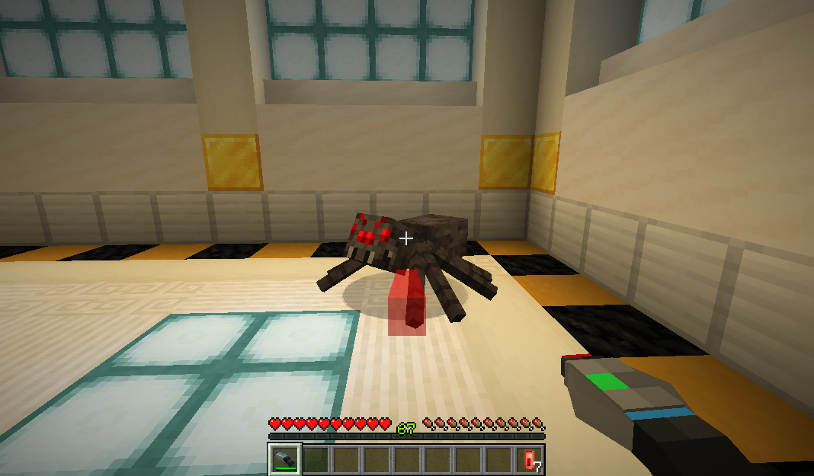
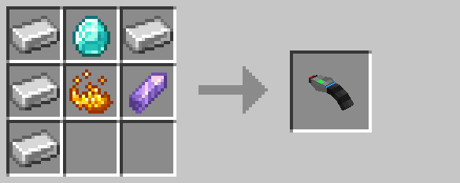

# Laser Blaster

The laser blaster is a ranged weapon that consumes [redstone energy cells](redstone_energy_cell.md) to fire laser pulses.

The laser blaster has no cooldown between individual uses.  However, each use of the laser blaster adds 20 units of heat to the player's heat score.  If the player's heat score exceeds 100 units, the laser blaster will overheat and refuse to fire until it returns below 100 units.  Heat dissipates naturally at a rate of one unit per tick.

|     Attribute     | Value |
| ----------------- | ----- |
| Durability        |  250  |
| Projectile Damage |   4   |

## Crafting

## History

| Version | Changes |
| ------- | ------- |
| R4      | Added laser blaster |
