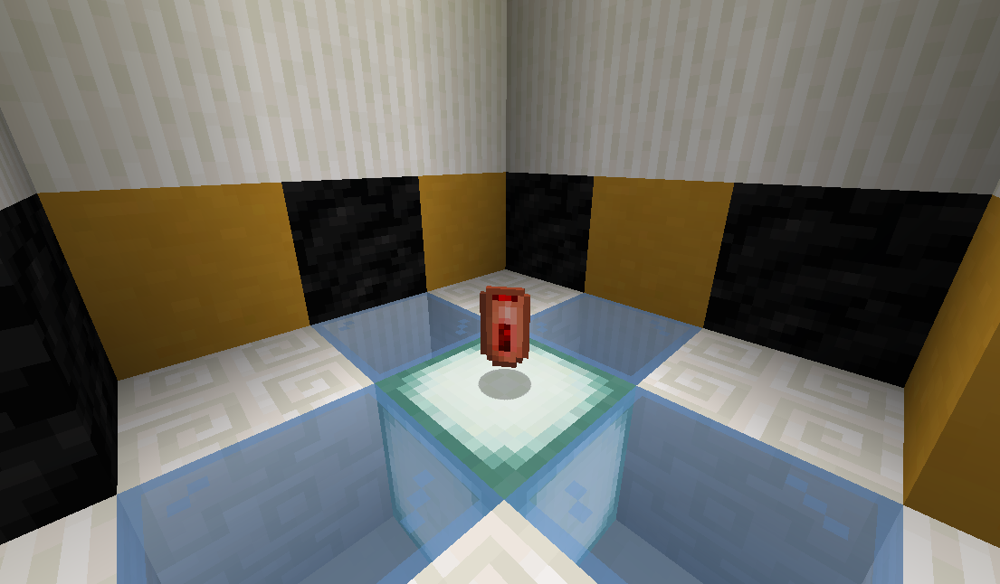
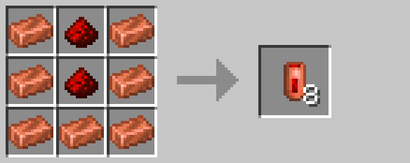

# Redstone Energy Cell

The redstone energy cell is a consumable item used by the [laser blaster](laser_blaster.md) as ammunition.

## Crafting

## History

| Version | Changes                    |
| ------- | -------------------------- |
| R4      | Added redstone energy cell |

