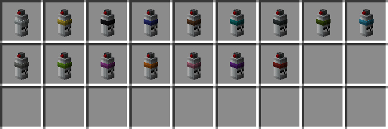
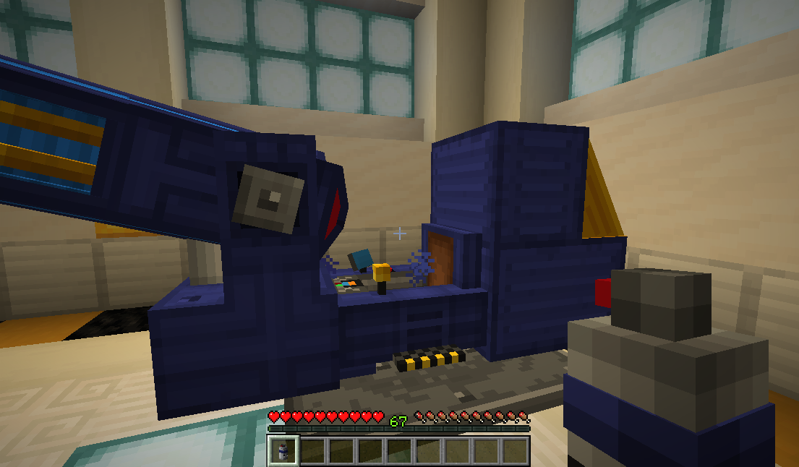
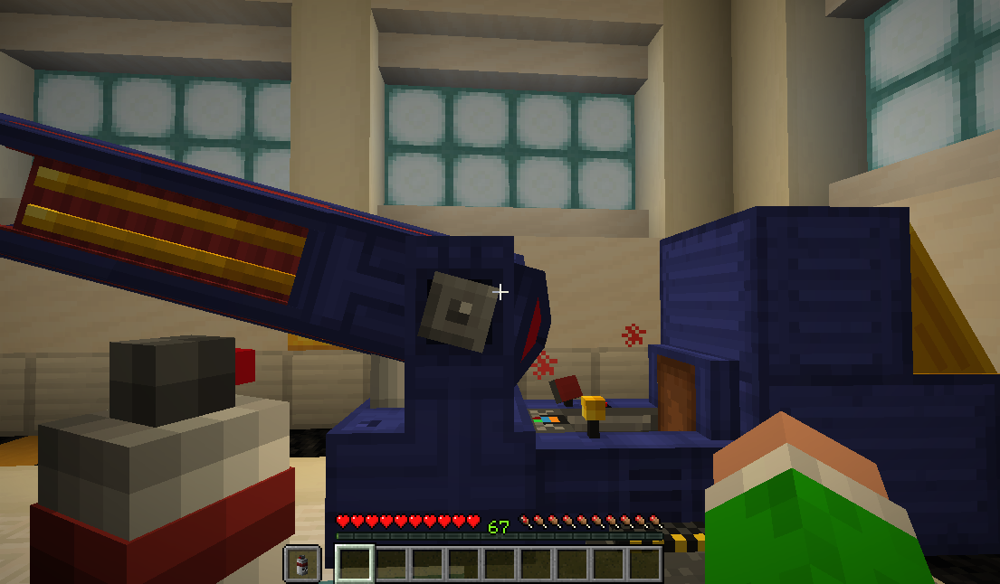
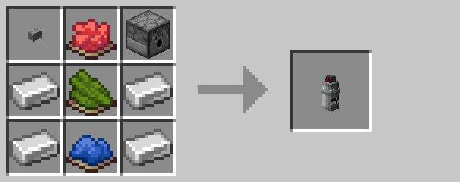

# Spray Can

The spray can is used to dye [drones](drone.md), [turrets](turret.md), and [air defense cannons](air_defense_cannon.md).  The spray can can apply one of sixteen colors to the target's primary and secondary colors.  Holding sneak and right-clicking cycles between the sixteen available colors.

Right-clicking with the spray can in the **main hand** will set the target's primary color:

Conversely, right-clicking with the spray can in the **off hand** sets the target's secondary/detail color:

## Crafting

## History

| Version | Changes         |
| ------- | --------------- |
| R4      | Added spray can |

