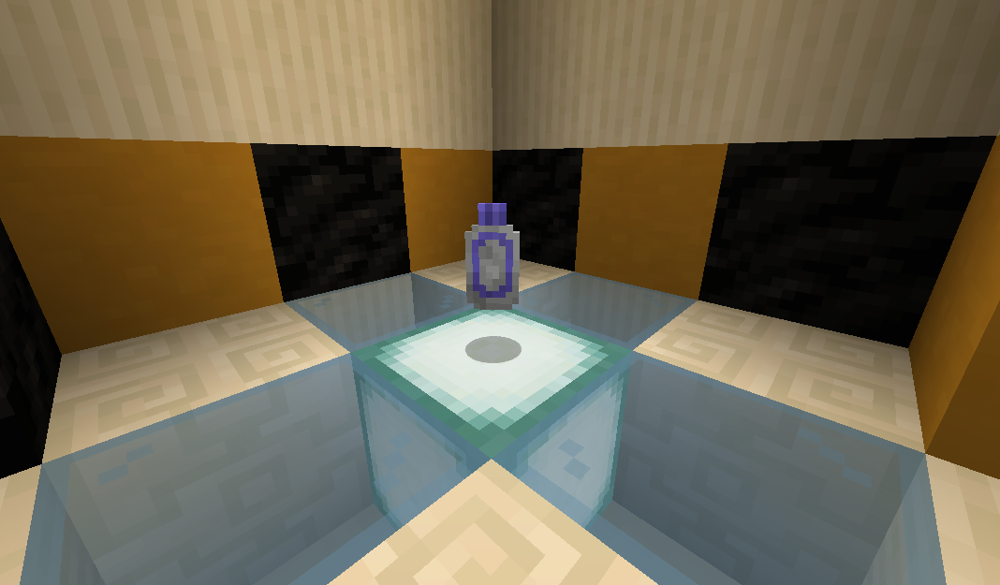

# Suspicious Thumb Drive

The suspicious thumb drive causes [drones](drone.md) and [turrets](turret.md) to turn rogue.  Rogue, [drones](drone.md) and [turrets](turret.md) will cease targeting most hostile mobs, and instead attack players and other friendly mobs.  Unlike other upgrades, this item has unlimited uses.

Upgrades are applied by right-clicking on the target entity.

## Obtaining

Suspicious thumb drives are found in the [abandoned bunker](abandoned_bunker.md) structure.

## History

| Version | Changes |
| ------- | ------- |
| R4      | Added suspicious thumb drive |
